# Architecture

RAG Quality Monitor is a modular monolith: one Python package, one database, one
process. There is no message broker, no service mesh and no mandatory cloud
dependency. Everything that could be a separate microservice is a module with a
clear interface, so it can be extracted later if a deployment really needs it.


> Source: [`docs/diagrams/architecture.mmd`](diagrams/architecture.mmd).
> Regenerate the SVG with `node scripts/render_diagrams.mjs`.

## Module map

| Package | Responsibility | Key entry points |
|---|---|---|
| `app.metrics` | Metric plugins, provenance, evidence requirements | `MetricSpec`, `register_metric`, `metric_catalogue` |
| `app.metrics.retrieval` | Precision/Recall/Hit/MRR/MAP/NDCG, context precision & recall | `precision_at_k`, `ndcg_at_k` |
| `app.metrics.answer` | Exact match, normalised match, token F1, faithfulness, hallucination, abstention | `token_f1_value`, `claim_support` |
| `app.metrics.citation` | Structural validity vs. genuine support, claim attribution | `classify_citations` |
| `app.metrics.operational` | Latency, tokens, cost, error rate | `OPERATIONAL_METRICS` |
| `app.providers` | Provider adapters, presets, pricing, failover, budgets | `build_provider`, `FailoverProvider`, `BudgetGuard` |
| `app.retrievers` | Chunking + BM25 / TF-IDF / hash-embedding retrievers | `build_retriever`, `chunk_document` |
| `app.ingestion` | Safe document and benchmark parsing | `parse_document`, `parse_dataset_file` |
| `app.rag` | The built-in RAG pipeline and the generic REST adapter | `SampleRAG`, `run_rest_adapter` |
| `app.evaluation` | Run orchestration, aggregation, LLM judging | `execute_run`, `aggregate_results`, `run_judge` |
| `app.gates` | Release policies, paired statistics, verdicts | `evaluate_gate`, `RunView` |
| `app.drift` | PSI / KS / JSD, control charts, run-to-run analysis | `analyse` |
| `app.reports` | JSON / CSV / Markdown / HTML / CI summaries | `run_to_dict`, `to_ci_summary` |
| `app.api` | FastAPI routers and request schemas | `ROUTERS` |
| `app.scheduler` | Recurring evaluations | `Scheduler` |
| `app.security` | Redaction, path safety, constant-time comparison | `redact_obj`, `safe_join` |
| `app.seed` | Reproducible demo data | `seed` |

## Evaluation lifecycle



> Source: [`docs/diagrams/evaluation-lifecycle.mmd`](diagrams/evaluation-lifecycle.mmd).

A run moves through these states:

1. **Queued** — the run row is created with an `idempotency_key`. A duplicate
   submission returns the existing run instead of starting a second one.
2. **Running** — a bounded worker pool executes the items. Each item result is
   committed on its own, so an interrupted run keeps the evidence it already
   produced.
3. **Scoring** — every registered metric is computed for the item. A metric
   whose evidence is missing returns `None` plus a reason; it is never replaced
   by a fabricated value.
4. **Aggregated** — per-item values become run-level metrics with a value, the
   number of contributing items (`n`) and the metric kind.
5. **Completed / Failed / Cancelled** — the run snapshot records the dataset
   checksum, the corpus manifest, the chunking configuration, the retriever,
   the generator, the evaluation code version, the seed and the budget usage.
6. **Gated** — a policy is evaluated against the candidate (and, for relative
   rules, against an approved baseline).

## Reproducibility contract

Every run stores a `config_snapshot` containing:

| Field | Why it matters |
|---|---|
| `dataset_checksum` | The benchmark content hash — two runs are only comparable if it matches |
| `corpus_manifest` | Document ids, revisions and content fingerprints |
| `n_chunks`, `chunk_stats` | Chunking configuration and its effect on the corpus |
| `retriever`, `top_k`, `chunk_chars`, `overlap_chars` | Retrieval configuration |
| `generator` | The provider and model that produced the answers |
| `eval_code_version` | The version of the evaluation code |
| `seed` | Random seed (the built-in pipeline is deterministic) |
| `budget` | The spend limit and what was actually spent |

The release gate refuses to compare two runs whose dataset checksums differ;
the comparison endpoint returns an explicit `comparable: false` flag.

## Data flow of a single evaluation

```
dataset item
   │
   ├── retrieval phase  ──▶ top-k chunks + scores
   │        │
   │        └── metrics: precision@k, recall@k, hit@k, MRR, MAP, NDCG@k,
   │                     context precision/recall, coverage, duplicate rate
   │
   ├── generation phase ──▶ answer + citations
   │        │
   │        └── metrics: exact/normalized match, token F1, completeness,
   │                     faithfulness*, claim support, hallucination*,
   │                     relevancy*, contradiction, abstention
   │
   ├── citation phase   ──▶ per-citation outcome
   │        │
   │        └── metrics: presence, structural validity, support, precision,
   │                     document recall, claim attribution, coverage
   │
   └── operational      ──▶ latency (p50/p95/p99), tokens, cost, errors
```

`*` = heuristic estimate, clearly labelled as such in every report.

## Extension points

### A new metric

```python
from app.metrics import MetricContext, MetricResult, register_metric

class MyMetric:
    name = "answer_length"
    kind = "operational"          # deterministic | reference_based | heuristic
    requires = ()                 # documented evidence requirements
    description = "Average answer length in tokens."

    def compute(self, ctx: MetricContext) -> MetricResult:
        if not ctx.answer:
            return MetricResult.missing("no answer")
        return MetricResult(value=len(ctx.answer.split()), kind="operational",
                            evidence={"answer": ctx.answer[:120]})

register_metric(MyMetric())
```

The metric is immediately available in every run, in the API catalogue and in
the dashboard.

### A new provider

Subclass `app.providers.base.BaseProvider`, implement `_call_once` (and
optionally `list_models` / `embed`), then register the kind in
`app/providers/__init__.py` (`_PROTOCOL_FOR_KIND`).

### A new retriever

Implement `search(query, top_k) -> list[dict]` and register the kind in
`app/retrievers/__init__.py`. A vector-database adapter only needs this
interface.

## Concurrency and durability

* Background runs execute on a `ThreadPoolExecutor` with a bounded worker
  count (`RQM_MAX_WORKERS`).
* Each item result is committed individually — an interrupted job is
  recoverable and auditable.
* Cancellation is checked between items; a cancelled run keeps its results and
  is marked `cancelled`.
* The scheduler is idempotent per tick and records `last_run_id` / `next_run_at`.
